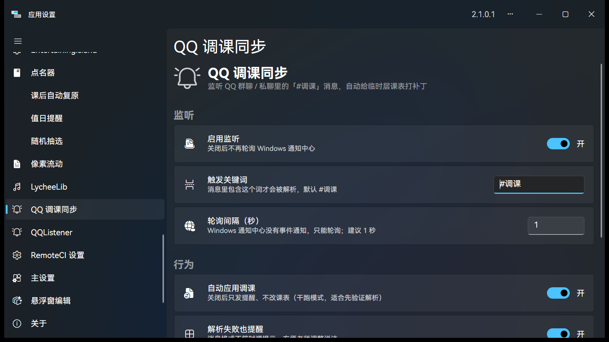
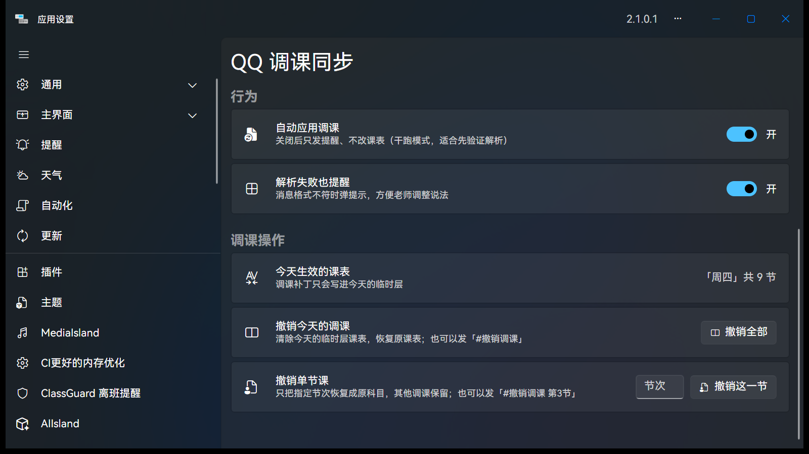
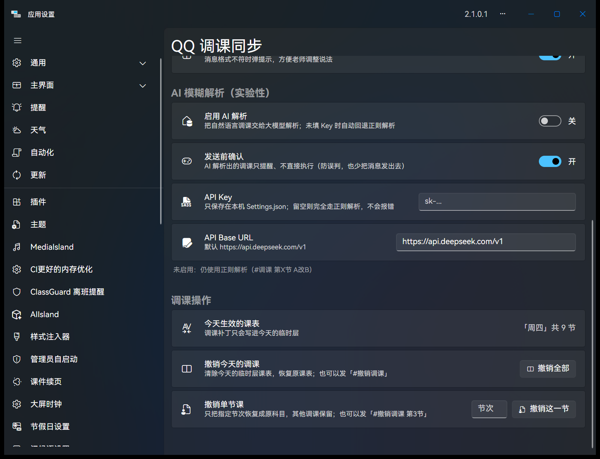

# QQ 调课同步（QqClassSync）

[](https://github.com/MuttonIsHere/QqClassSync/releases)
[](https://github.com/MuttonIsHere/QqClassSync)
[](https://github.com/ClassIsland/ClassIsland)

监听 QQ 群聊 / 私聊里的「#调课」消息，自动给 ClassIsland 的**临时层课表**打补丁，并在大屏弹出提醒。

> 与「小橙看班」项目完全独立。本目录是独立新项目。

## 截图

设置页（监听 / 触发关键词 / 轮询间隔 / 行为开关）：



调课操作区（今日生效课表 + 一键撤销）：




## 目录结构

```
qq-sync/
├── ref/                     参考仓库（浅克隆）
│   ├── ClassIsland/         ClassIsland 主仓库（IPublicProfileService 源码依据）
│   ├── QQListener/          BSOD-MEMZ/QQListener（Python 版参考）
│   └── QQListener-alright/  alright-qwq/QQListener（本机已装插件的 C# 源码）
├── spike/
│   ├── QqNotifyProbe/       任务1：控制台通知探针（.NET 8）
│   └── legacy-csc/          早期无 SDK 时的 csc 探针（已归档，仅留作记录）
├── plugin/QqClassSync/      任务3：ClassIsland 插件
└── tools/FakeQqToast/       测试用假通知发送器
```

## 任务1：UserNotificationListener 探针

`spike/QqNotifyProbe` 是极简控制台程序：

```powershell
dotnet run --project qq-sync/spike/QqNotifyProbe -- 40
```

**结论（本机实测）**

| 问题 | 结论 |
|---|---|
| 能否拿到权限 | ✅ `AccessStatus = Allowed`（ClassIsland 宿主进程里也是 Allowed） |
| 能否读到 QQ Toast | ✅ 能，AppInfo 也可用（App 名 = `QQ`，AUMID = `QQ`） |
| 事件 `NotificationChanged` | ❌ 订阅抛 `COMException 0x80070490`，无包身份时事件不可用 |
| 可行方案 | **必须轮询** `GetNotificationsAsync(NotificationKinds.Toast)` |

**坑与规律**

1. `RequestAccessAsync` 必须在 UI 线程调用（STA + 消息泵；插件里走 Avalonia `Dispatcher.UIThread`）。
2. 权限按「可执行文件所在目录」记忆：在 `Documents\deepseek-harness\default-workspace` 下运行曾被判 `Denied`，
   同一 exe 复制到 `%TEMP%`、桌面、ClassIsland 应用目录均 `Allowed`。插件部署在 ClassIsland 应用目录，不受影响。
3. QQ Toast 的文本结构：`text[0]` = 群名，`text[1]` = 「发送者：内容」。

## 任务2：IPublicProfileService 临时层课表

接口定义：`ClassIsland.Shared.IPC/Abstractions/Services/IPublicProfileService.cs`
插件里注入的是 `ClassIsland.Core.Abstractions.Services.IProfileService : IPublicProfileService`。

实现在 `ClassIsland/Services/ProfileService.cs`，关键语义：

- `CreateTempClassPlan(id, ...)`：**复制**源课表 → 标记 `IsOverlay = true`、`OverlaySourceId = id`、
  名字加「（临时层）」，挂到 `Profile.OrderedSchedules[今天]`，并把 `Profile.OverlayClassPlanId` 指向它。
  今天已有临时层时返回 `null`（不会重复创建）。
- `ClassPlan.Classes` 与时间表里 `TimeType == 0`（上课）的时间点一一对应 ⇒ **第 X 节 = `Classes[X-1]`**。
- 改课就是把 `Classes[i].SubjectId` 换成目标科目 GUID，并 `IsChangedClass = true`。
- `ClearTempClassPlan()` 清掉当天临时层；`SetupTempClassPlanGroup(key)` / `ClearTempClassPlanGroup()` 用于整组临时课表。
- 改完必须 `SaveProfile()`。

## 任务3：插件

```
plugin/QqClassSync/
├── Plugin.cs                          [PluginEntrance] 注册服务
├── Services/TiaokeParser.cs           解析「#调课 第X节 A改B」与「#撤销调课 [第X节]」
├── Services/QqToastScanner.cs         轮询通知中心 → 筛 QQ → 去重
├── Services/TempClassPlanPatcher.cs   打临时层课表补丁 / 整天撤销 / 单节撤销
├── Services/LessonUndoJournal.cs      调课改动日志（单节撤销的数据基础）
├── Services/TiaokeNotificationProvider.cs  提醒提供方 + 后台循环
├── Services/TiaokeSettings.cs         设置（Settings.json）
├── Views/TiaokeSettingsPage.axaml     设置页
└── manifest.yml
```

构建（含 `.cipx` 打包）：

```powershell
cd qq-sync/plugin/QqClassSync
dotnet build -c Release -p:CreateCipx=true -p:PowershellBinaryName=powershell
# 产物：bin/Release/net8.0-windows10.0.19041.0/QqClassSync.dll
#       cipx/QqClassSync.cipx（= 输出目录 zip + checksums.md MD5 清单）
```

> `.cipx` 由 `ClassIsland.PluginSdk` 的 `CreateCipx` target 生成，默认用 `pwsh`；本机只有 Windows PowerShell 5.1，
> 所以要传 `-p:PowershellBinaryName=powershell`。

部署（文件夹版）：

```powershell
Copy-Item .\bin\Release\net8.0-windows10.0.19041.0\* `
  "<ClassIsland 安装目录>\data\Plugins\QqClassSync\" -Force
```

设置文件：`<ClassIsland>\data\Config\Plugins\qq.classsync\Settings.json`

```json
{
  "Enabled": true,
  "Keyword": "#调课",
  "ScanIntervalSeconds": 1,
  "AutoApply": true,
  "NotifyOnParseFailure": true,
  "AllowedAppNames": ["QQ", "腾讯QQ", "TIM"],
  "AllowedAppIds": ["Tencent.QQNT", "com.tencent.qq", "com.tencent.tim", "QQ"]
}
```

- `AutoApply = false`：干跑模式，只提醒不改课表（方便先验证解析）。
- `AllowedAppNames` / `AllowedAppIds`：通知来源白名单，联调时可加入测试应用。
- **群聊 / 私聊 / 系统消息都能收**：插件只判断「是不是 QQ 的 Toast」和「文本里有没有关键词」，不区分聊天类型。

## 🔐 AI 解析配置与密钥安全（v1.2.0）

设置页新增「AI 模糊解析（实验性）」区块：



| 配置项 | 默认 | 说明 |
|---|---|---|
| 启用 AI 解析 | **关** | 关着就完全走正则，不碰网络 |
| 发送前确认 | **开** | AI 解析结果只提醒、不直接执行 |
| API Key | **空** | 只存本机 `Settings.json`；留空自动回退正则 |
| API Base URL | `https://api.deepseek.com/v1` | 可改成任意 OpenAI 兼容接口 |

**「留空不崩」是怎么保证的**

- AI 是否可用由 `AiParsePolicy.IsConfigured(开关, Key, BaseUrl)` 三重判定，任一不满足即 `false`
- 解析路由：**先正则**（命中就结束，快、免费、离线）→ 未命中且 AI 可用才尝试 AI → AI 不可用/异常一律返回 `null` 并静默回退
- 启动日志可核对：`AI 解析：未启用或未填写 Key，使用正则解析（不会报错）`

**调用细节（v1.2.0 起真正联网）**

- `POST {BaseUrl}/chat/completions`，`model: deepseek-chat`，`temperature: 0`，强制 JSON 输出
- **8 秒超时**；超时 / 网络错误 / HTTP 非 2xx / 返回格式不对 → 一律返回 `null`，静默回退正则
- **意图预筛**：只有像调课的消息（含「调课/换课/代课/不上/来上/换成…」）才会送进大模型，闲聊不消耗 token
- **发送前确认**（默认开）：AI 解析出结果先弹「检测到 AI 解析调课：第3节 →数学，是否应用？」，在 QQ 里回 `#确认` 应用、`#放弃` 取消（10 分钟有效）
- 日志红线：**不打印 QQ 消息原文、不打印模型返回原文、不打印 Key**，只允许
  「尝试调用 AI 解析 / AI 解析成功 / AI 调用失败（超时/网络错误/HTTP 错误/返回格式无法解析）」

**密钥安全**

- 真实配置在 `<ClassIsland>\data\Config\Plugins\qq.classsync\Settings.json`，**在 ClassIsland 的 data 目录里，本来就不在仓库内**
- `.gitignore` 额外兜底：`Settings.json`、`TempPatches.json`、`*.local.json` 一律不入库
- 仓库只放样例：[Settings.sample.json](Settings.sample.json)，Key 为占位符 `sk-xxxxxxxx`
- Key 不做环境变量（对老师门槛太高），只存本地文件
- 日志与设置页状态只显示脱敏值（`sk-12…abcd`）
- 开源项目「敢发代码」的原因：代码里没有 Key，Key 是使用者运行时自己填的数据；泄露只发生在误提交配置文件或硬编码时

## 🔗 与「小橙看班联动」打通（v1.3.0）

有的老师不在 QQ 群发指令，而是在**小橙看班**里发「全屏播报 / 班级通知」，内容写「下午第三节语文改数学」。

**架构：单一解析大脑 + 消息源适配器（双源输入）**

```
                    ┌──────────────────────────── QqClassSync（唯一大脑）────────────────────────────┐
                    │                                                                              │
QQ 群聊/私聊 ───────┤ UserNotificationListener（1s 轮询）──┐                                          │
  (Windows Toast)   │                                     ├─→ 解析管线：正则 →(未命中)→ AI → 临时层课表 │
                    │                                     │        ↓                              │
小橙看班通知 ───────┤ XiaoChengLink 读 Data.idb ──转发─────┘   大屏提醒（标注来源）                 │
  (全屏播报/班级通知)│   ↑ 即时触发 + 30s 兜底轮询              ↓                              │
                    │   └────────── QqClassSync.Bridge.TiaokeBridge.Submit(text, source) ──────────┘
                    └──────────────────────────────────────────────────────────────────────────────┘
```

- **两个来源、一套逻辑**：不管消息从 QQ 还是小橙看班来，最终都进同一个解析器 + 同一个临时层补丁，
  行为完全一致（含 `#撤销调课`、AI 模糊解析、发送前确认）。
- **桥接契约**：`QqClassSync.Bridge.TiaokeBridge.Submit(string text, string source)`，
  对方通过反射按类型名调用，**不编译期引用**，任一方升级都不会让另一方加载失败。
- **来源可追溯**：非 QQ 来源在提醒正文里带 `【来源：小橙看班】`。
- **兜底轮询**：小橙看班每 30 秒读一次 `Data.idb`（`tiaokeLinkPollSeconds`，0 = 关闭），
  避免「不弹窗的通知」被漏掉。
- **确认指令通用**：AI 待确认时，`#确认` / `#放弃` 发在 QQ、或发在小橙看班里都能生效。

对应版本：`qq.classsync 1.3.0.0` + `xiaocheng.link 2.0.2.0`。

## 🕳️ 避坑指南（本项目踩过的坑都在这）

### 1. 通知对象必须在 UI 线程构建

`NotificationContent.CreateTwoIconsMask` 内部会 `new LucideIconSource`（Avalonia 对象），
在轮询线程构造会抛 `Call from invalid thread`，提醒直接发不出去。
**修法**：整个 `NotificationRequest` 都投递到 `Dispatcher.UIThread` 构建。

### 2. 「今天该用哪张课表」不能查 OrderedSchedules

`Profile.OrderedSchedules` 只存「某天临时指定用哪张课表」，正常日子是空的。
**修法**：`ILessonsService.GetClassPlanByDate(today, out var id)`，它按
「预定课表 → 临时课表 → 课表组/时间规则匹配」选出当天课表。

### 3. ⚠️ 修改课表也必须在 UI 线程（v1.2.0 排掉的雷）

`CreateTempClassPlan()` 会写 `Profile.OverlayClassPlanId`，而 ClassIsland 的课表网格
（`ScheduleDataGrid`）订阅了 `Profile` 的变化；在后台线程改课表会触发 UI 控件属性读取，
抛 `Call from invalid thread`，异常还会被上层 catch 吞掉 —— 表现为「大屏毫无反应」。

**修法**：把 `CreateTempClassPlan` / `Classes[i].SubjectId = ...` / `SaveProfile()` 整段放进
`Dispatcher.UIThread.InvokeAsync(...)` 执行；并且**执行失败必须弹提醒 + 写日志**，不能静默吞掉。

### 4. 关键词闸门会挡掉自然语言

老师发「今天第三节课不上了，让数学老师来上」时不包含 `#调课`，如果入口先按关键词过滤，
AI 永远看不到这条消息。
**修法**：AI 开启时用「意图预筛」（调课/换课/代课/不上/来上/换成…）作为第二入口；
不属于指令也像闲聊的消息保持静默，不刷屏提示格式错误。

## 已验证 / 待验证

已验证（真机 + 日志证据）：

- 插件被 ClassIsland 2.1.0.1 加载：`QQ 调课同步(qq.classsync,1.2.0.0)`
- 提醒提供方注册：`注册提醒提供方：b7f3c1a2-...（QQ 调课同步）`
- 后台启动 + 权限：`QQ 调课同步已启动（间隔 1s…）`、`通知监听权限：Allowed`
- 探针在真实 QQ 群消息上抓到 Toast（群名 + 发送者：内容）
- **真实私聊 `#调课 第3节 语文改数学` → 大屏弹「调课已同步」+ 课表即时变更**
- 设置页打开无绑定错误；「撤销今天的调课」按钮恢复原课表
- **v1.2.0 真机实测（老师自然语言）**：发「今天第三节课不上了，让数学老师来上」→
  秒弹「AI 调课（待确认）」→ 回 `#确认` → 课表第 3 节变为数学、课表名出现「（临时层）」

## 单节课精准撤销（v1.1.0）

`ClearTempClassPlan()` 只能整天清空，所以插件自己维护了一份**调课改动日志**
（`TempPatches.json`，与 `Settings.json` 同目录）：

```json
{
  "Records": [
    {
      "Date": "2026-11-12",
      "Lesson": 3,
      "OriginalSubjectId": "…",
      "OriginalSubjectName": "语文",
      "NewSubjectId": "…",
      "NewSubjectName": "数学",
      "CreatedAt": "2026-11-12T19:50:00"
    }
  ]
}
```

撤销逻辑：

1. 收到 `#撤销调课 第3节`（或设置页「撤销这一节」）
2. 从日志里取出该节**最近一条**记录（栈式：同一节改过两次就先撤最近一次）
3. 把该节 `SubjectId` 写回原科目，`IsChangedClass = false`，`SaveProfile()`
4. 其他节次的调课**保持不变**
5. 如果所有节次都已和源课表一致 → 顺手调用 `ClearTempClassPlan()`，避免课表名一直挂着「（临时层）」

> 日志里没有记录时（日志被清空/插件重装），会退回到「临时层的源课表」读取原科目，保证仍能撤销。

单元测试见 [tests/ParserTests/JournalTests.cs](tests/ParserTests/JournalTests.cs)（栈式撤销、持久化、过期清理等 8 条用例）。

## 🗣️ 老师操作卡（可以直接照着念）

### 三句话记住三个操作

| 想做什么 | 在 QQ 里发 | 例子 |
|---|---|---|
| 换一节课 | `#调课 第X节 原科目改新科目` | `#调课 第3节 语文改数学` |
| 一次换多节 | `#调课 第X节 …，第Y节 …` | `#调课 第3节 语文改数学，第5节 英语改物理` |
| 两节一起换 | `#调课 第X节和第Y节都换成科目` | `#调课 第1节和第2节都换成自习` |
| 两节对调 | `#调课 第X节和第Y节互换` | `#调课 第3节和第5节互换` |
| 只撤销某几节 | `#撤销调课 第X,Y节` | `#撤销调课 第3,5节` |
| 撤销今天全部调课 | `#撤销调课` | `#撤销调课` |

### 批量调课（v1.4.0）

- **一条消息最多 10 条**调课指令，用逗号 / 分号 / 顿号分隔都行
- **AI 自然语言也支持批量**：「今天下午第1节和第2节都换成自习，另外第4节音乐改美术」
- **只落盘一次**：多条指令在 UI 线程里一次性改完临时层，只调用一次 `SaveProfile()`，不会连续写文件
- **部分成功**：3 条里 1 条科目写错时，正确的先改，错误的在大屏提示
  （例：`已执行：第3节 语文→数学；失败：第5节找不到科目「物理」，已跳过`）
- **确认列表**：AI 解析出多条时会列成 `1. 第3节…；2. 第5节…`，回 `#确认` 应用全部

### 发出去之后会发生什么

- **1 秒内大屏弹提示**：
  - 换课成功 → 「调课已同步：第 3 节：语文 → 数学」
  - 单节撤销 → 「调课已撤销：第 3 节已恢复为 语文，其余调课保留」
  - 撤到没有调课了 → 「……今天已无调课，临时层已清除」
- **大屏课表立刻改变**；原课表不会被改动，第二天自动恢复

### 写法小贴士（这些都认得）

- 节次：阿拉伯数字 `3`、中文数字 `三` / `十二` 都行
- 「改」字：`改` / `改成` / `换成` / `改为` / `换为` 都行
- 群聊、私聊、给自己发都行（只要在 QQ 里）
- 关键词默认 `#调课`，可在设置页修改；`#撤销调课` 始终有效

### 常见问题（老师版）

- **发了没反应？** 检查三件事：① QQ 窗口别挡在大屏前面（前台时 QQ 不弹通知）；② 消息里要有 `#调课`；③ 科目名要和课表里的一致（写「语文」，别写「语」）
- **改错了？** 发 `#撤销调课 第X节` 恢复那一节
- **只记得改过课、不记得第几节？** 发 `#撤销调课` 撤销今天全部
- **撤销后还想再改？** 直接再发一次 `#调课 ...`，会重新建临时层

### 设置页对照（给管理员）

- **自动应用调课** 关掉 = 干跑模式：只弹提示、不改课表，适合先培训老师
- **撤销单节课**：填节次点按钮，等同发 `#撤销调课 第X节`
- **撤销今天的调课**：等同发 `#撤销调课`
- **今天生效的课表**：实时显示当前课表名与调课处数，方便核对

## 已知限制

- `NotificationChanged` 事件需要包身份，插件采用 1 秒轮询；轮询有 512 条去重窗口。
- 权限绑定宿主进程：若 ClassIsland 侧被拒，`Allowed` 会失败并弹一次提示。
- 单节课撤销依赖改动日志：日志文件被删后只能退回到「源课表」整体还原该节。
- 模糊指令（自然语言 → JSON）尚未实现，计划接入大模型解析（需要 API Key 与隐私开关）。
