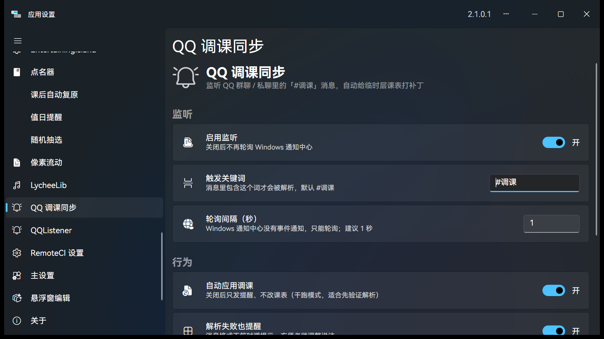

# QQ 调课同步 v1.0.0

> 群里发一句「#调课 第3节 语文改数学」，教室大屏上的课表立刻跟着变。

监听 QQ 群聊 / 私聊里的「#调课」消息，自动给 ClassIsland 的**临时层课表**打补丁，并在大屏弹出提醒。



## ✨ 功能一览

| 能力 | 说明 |
|---|---|
| 解析调课 | `#调课 第3节 语文改数学`，支持中文数字、`改成 / 换成 / 改为 / 换为` 等写法 |
| 解析撤销 | `#撤销调课`、`#取消调课`（可带 `第X节`，但撤销是整天级别） |
| 只改一节 | 自动创建/复用**今天的临时层课表**，只改指定节次，原课表不动 |
| 大屏提醒 | 通过 ClassIsland 提醒渠道弹出，走宿主既有的遮罩/语音/音效配置 |
| 群聊 + 私聊 | 只判断「来源是 QQ」+「文本含关键词」，不区分聊天类型 |
| 设置页 | 启用监听、触发关键词、轮询间隔、干跑模式、撤销按钮 |

## 🚀 安装

1. 下载本页下方的 `QqClassSync.cipx`
2. ClassIsland → 应用设置 → 插件 → 安装插件 → 选择该文件
3. 重启 ClassIsland，首次运行会请求通知监听权限
   - 若失败：检查 Windows 通知设置是否允许访问通知，然后重启 ClassIsland

> 也可以把 `.cipx`（本质是 zip）解压成文件夹，放到 `<ClassIsland 安装目录>\data\Plugins\QqClassSync\`。

## ⌨️ 指令

```
#调课 第3节 语文改数学
#调课 第五节 化学换成生物
#撤销调课
```

- 撤销是**整天级别**的：`ClearTempClassPlan()` 会清掉当天所有临时层改动
- QQ 窗口在前台时通常不弹 Toast，测试时建议从手机发送
- 科目名要和 ClassIsland 档案里的科目名（或简称）一致，否则会提醒「找不到科目」

## 🧠 实现要点

- **通知来源**：`Windows.UI.Notifications.Management.UserNotificationListener`，实测无包身份时 `NotificationChanged` 事件不可用，因此采用 1 秒轮询 `GetNotificationsAsync`
- **权限**：`RequestAccessAsync()` 必须在 UI 线程调用，插件通过 Avalonia `Dispatcher.UIThread` 投递
- **改课表**：`ILessonsService.GetClassPlanByDate()` 取当天生效课表 → `IProfileService.CreateTempClassPlan()` 建临时层 → 改 `Classes[节次-1].SubjectId` → `SaveProfile()`
- **撤销**：`IProfileService.ClearTempClassPlan()`

## ⚠️ 已知限制

- 依赖 Windows 通知中心；QQ 必须真的产生 Toast
- 权限绑定宿主进程，被拒时需要重启 ClassIsland 重新授权
- 撤销只能整天撤销，不支持只回滚某一节

## 📦 文件

- `QqClassSync.cipx` —— 插件包（manifest / icon / dll）

---

源码：<https://github.com/MuttonIsHere/QqClassSync>
