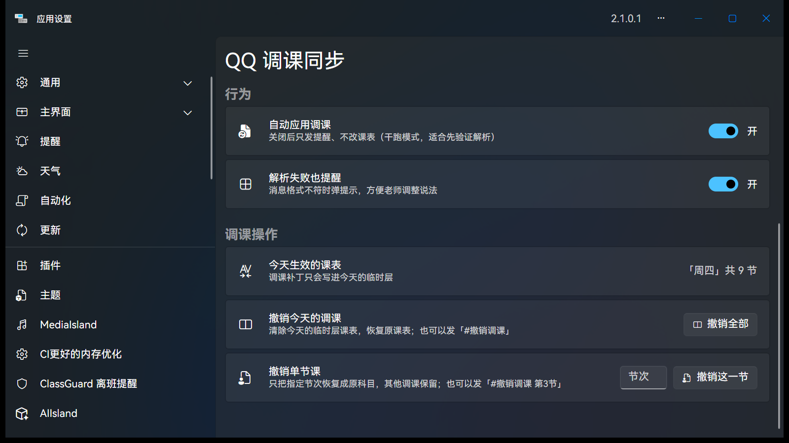

# QQ 调课同步 v1.1.0

> v1.1.0 的重点：**撤销可以只撤一节了**。

## 🆕 新增

- **单节课精准撤销**：发 `#撤销调课 第3节`，只把第 3 节恢复成原科目，其他调过的节次保留。
- **设置页新增「撤销单节课」**：填节次点按钮即可，和发指令等价。
- **调课改动日志**（`TempPatches.json`）：每次调课记录「第几节、原科目、新科目」，
  栈式撤销（同一节改两次先撤最近一次），按日期保留最近 7 天。
- **自动收尾**：所有调课都撤销后，自动清除临时层，课表名不会一直挂着「（临时层）」。

## 🔁 与 v1.0 的区别

| 操作 | v1.0 | v1.1.0 |
|---|---|---|
| `#撤销调课` | 清除当天全部临时层 | 同左（不变） |
| `#撤销调课 第3节` | 也清除全天 | **只恢复第 3 节，其余保留** |

## 🗣️ 给老师的操作卡

| 想做什么 | 发什么 |
|---|---|
| 换一节课 | `#调课 第3节 语文改数学` |
| 只撤销某一节 | `#撤销调课 第3节` |
| 撤销今天全部 | `#撤销调课` |

- 节次支持 `3` / `三` / `十二`
- 支持 `改 / 改成 / 换成 / 改为 / 换为`
- 群聊、私聊都能用

## 🚀 安装 / 升级

1. 下载下方 `QqClassSync.cipx`
2. ClassIsland → 应用设置 → 插件 → 安装插件（覆盖旧版即可，设置会保留）
3. 重启 ClassIsland

> 从 v1.0 升级：`Settings.json` 会自动沿用；旧的临时层课表建议先在课表页清一次，再重新调课。

## 🧪 验证

- 单元测试 21/21 通过（新增 8 条日志用例：持久化、栈式撤销、按天清理、7 天过期）
- `dotnet build -c Release` 0 warning / 0 error，`.cipx` 正常产出
- 本机 ClassIsland 2.1.0.1 部署验证：插件启动、权限 Allowed、设置页渲染正常
- 真机真实消息验证：待下周教室实测（PR #1 里列了验证清单）

## ⚠️ 已知限制

- 单节撤销依赖改动日志；日志被删后只能退回「源课表」整体还原该节
- 撤销只能按节次，不支持「撤销某一条特定记录」
- 模糊指令（自然语言 → 大模型解析）尚未实现，视老师们真实使用习惯再定

---

源码与完整说明：<https://github.com/MuttonIsHere/QqClassSync>
