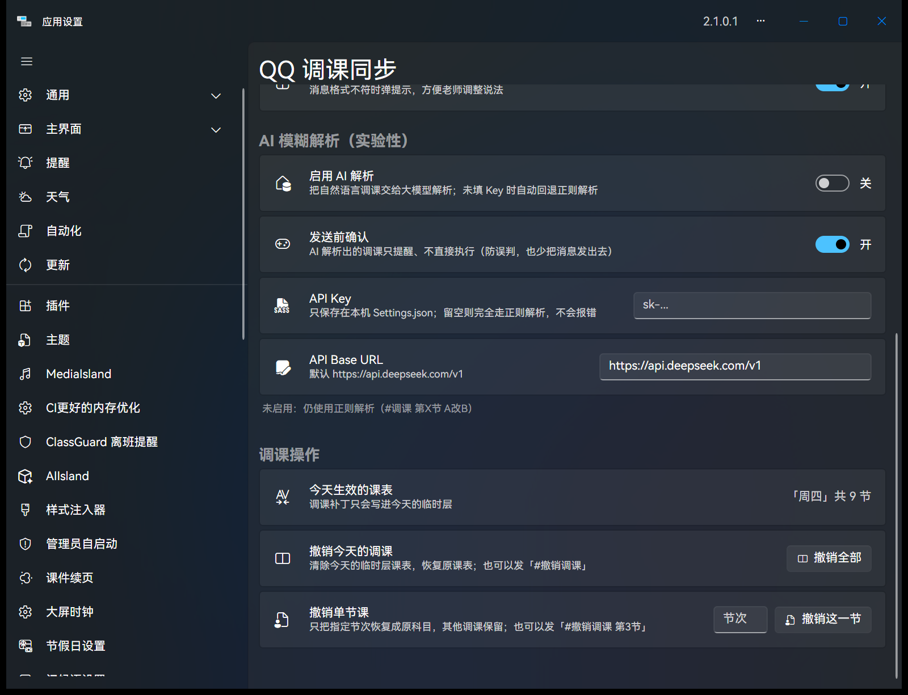

# QQ 调课同步 v1.1.1

> 本版只做 **AI 解析的配置层**：UI、读取/保存、留空兜底。模型调用留到下一版。

## 🆕 新增

设置页多了「AI 模糊解析（实验性）」区块：

| 配置项 | 控件 | 默认 |
|---|---|---|
| 启用 AI 解析 | 开关 | **关** |
| 发送前确认 | 开关 | **开** |
| API Key | 密码框（`●` 掩码） | **空** |
| API Base URL | 文本框 | `https://api.deepseek.com/v1` |

## 🛡️ 红线一：留空绝不崩，自动回退正则

- AI 可用性由 `AiParsePolicy.IsConfigured(开关, Key, BaseUrl)` 三重判定，**任一不满足就是 false**
- 解析顺序：**先正则**（命中即结束）→ 未命中且 AI 可用才尝试 AI → AI 未接入/异常一律返回 `null`，静默回退正则
- 启动日志可核对：`AI 解析：未启用或未填写 Key，使用正则解析（不会报错）`
- 老师发 `#调课 第3节 语文改数学` 仍然秒识别，和 v1.1.0 完全一致

单元测试覆盖：关闭/空 Key/空白 Key/空 BaseUrl/全 null → 全部判为「不走 AI」，共 14 条断言。

## 🔐 红线二：密钥安全

- 真实配置在 `<ClassIsland>\data\Config\Plugins\qq.classsync\Settings.json`，**不在任何 Git 仓库里**
- `.gitignore` 兜底：`Settings.json`、`TempPatches.json`、`*.local.json` 不入库
- 仓库只放占位样例：[`Settings.sample.json`](https://github.com/MuttonIsHere/QqClassSync/blob/main/Settings.sample.json)（`sk-xxxxxxxx`）
- 不使用环境变量（对老师门槛太高），Key 只存本地文件
- 设置页状态与日志只显示脱敏值（`sk-12…abcd`）

## 🚀 升级

1. 下载下方 `QqClassSync.cipx`
2. ClassIsland → 应用设置 → 插件 → 安装插件（覆盖即可，原有设置与调课日志保留）
3. 想试 AI：打开「启用 AI 解析」→ 填 Key → 重启 ClassIsland（本版不会真的调用模型，只验证配置保存）

## 🧪 验证

- 单元测试 **35/35 通过**（解析 13 + 调课日志 8 + AI 配置判定 14）
- `dotnet build -c Release` 0 warning / 0 error，`.cipx` 正常产出
- 本机部署 v1.1.1：启动日志显示「AI 解析：未启用或未填写 Key，使用正则解析（不会报错）」
- 设置文件自动补上 `AiEnabled=false` / `AiApiKey=""` / `AiBaseUrl` / `AiConfirmBeforeSend=true`

## ⚠️ 说明

- 本版**没有**接入模型调用：即使填了 Key，也仍走正则解析（日志会提示「本版本尚未接入模型调用」）
- 下一版接入计划：DeepSeek `/chat/completions`、8 秒超时、失败回退正则、发送前确认默认生效、日志不打印 Key 与消息正文
