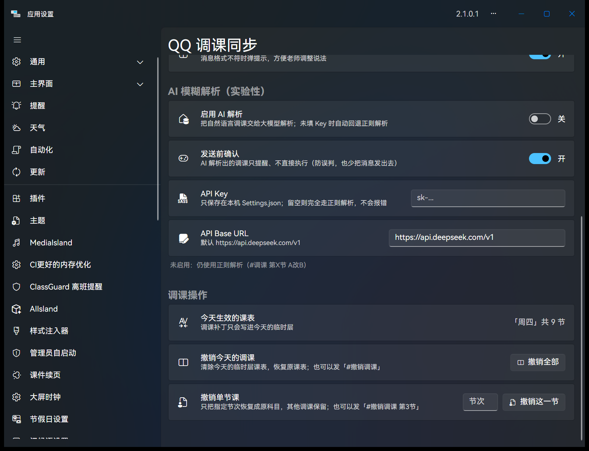

# QQ 调课同步 v1.2.0 —— AI 模糊解析，正式可用

> 老师不用记格式了。发一句「今天第三节课不上了，让数学老师来上」，大屏就能弹出待确认的调课。



## 🤖 新增：AI 模糊解析（真实联网）

- **接口**：`POST {BaseUrl}/chat/completions`（OpenAI 兼容，默认 DeepSeek `deepseek-chat`）
- **严格 JSON 输出**：`{"Lesson": 3, "OriginalSubject": "语文", "NewSubject": "数学"}`，没有调课意图就输出 `{}`
- **8 秒超时**：超时 / 网络错误 / HTTP 非 2xx / JSON 解析失败 → 一律静默回退正则解析
- **意图预筛**：只有像调课的消息（调课/换课/代课/不上/来上/换成…）才发给大模型，闲聊不消耗 token
- **发送前确认**（默认开）：先弹「检测到 AI 解析调课：第3节 →数学，是否应用？」，在 QQ 里回 `#确认` 应用、`#放弃` 取消（10 分钟有效）
- **隐私红线**：日志不打印 QQ 消息原文、不打印模型返回原文、不打印 Key；只出现
  「尝试调用 AI 解析 / AI 解析成功 / AI 调用失败（超时/网络错误/HTTP 错误/返回格式无法解析）」

## 🐛 修复：跨线程改课表导致「大屏毫无反应」

实测翻车现场：

```
System.InvalidOperationException: Call from invalid thread
   at ClassIsland.Controls.ScheduleDataGrid.get_SelectedDate()
   at Profile.set_OverlayClassPlanId()
   at ProfileService.CreateTempClassPlan(...)
   at TempClassPlanPatcher.Apply(...)
```

`CreateTempClassPlan()` 会触发 ClassIsland 课表网格（Avalonia 控件）的响应式刷新，
在后台轮询线程调用会被 UI 线程校验拦下，异常又被上层 catch 吞掉 → 表现为「发了 #确认 但什么都没发生」。

**修法**

- 把 `CreateTempClassPlan` / `Classes[i].SubjectId = ...` / `SaveProfile()` 整段放进 `Dispatcher.UIThread.InvokeAsync(...)`
- 执行异常不再静默：大屏弹「调课失败」并写完整日志
- 失败时**保留待确认状态**，可以再发 `#确认` 重试

## ✅ 验证

- 单元测试 **65 条断言全过**：解析 13 + 调课日志 8 + AI 配置判定 18 + AI 返回解析 17 + HTTP 集成 9
- HTTP 集成本机用假服务器验证：请求路径、`Bearer` 鉴权、`response_format`、成功解析、500 回退、空 Key 不发请求
- **真机实测（ClassIsland 2.1.0.1）**：
  发「今天第三节课不上了，让数学老师来上」→ 秒弹待确认 → 回 `#确认` → 第 3 节变数学、课表名出现「（临时层）」

## 🚀 升级

1. 下载下方 `QqClassSync.cipx`
2. ClassIsland → 应用设置 → 插件 → 安装插件（覆盖即可，设置与调课日志保留）
3. 设置页填 API Key → 打开「启用 AI 解析」→ **无需重启**，1 秒内生效

## ⚠️ 已知限制

- AI 结果依赖模型判断，所以默认开启「发送前确认」；确认后 10 分钟内有效
- 模型只说得出「第几节 + 新科目」时，原科目留空，提醒里会显示为「第3节 →数学」
- 撤销仍按节次回滚（`#撤销调课 第3节` / `#撤销调课`），不支持撤销某一条特定记录

---

完整说明（含「避坑指南」）：<https://github.com/MuttonIsHere/QqClassSync>
